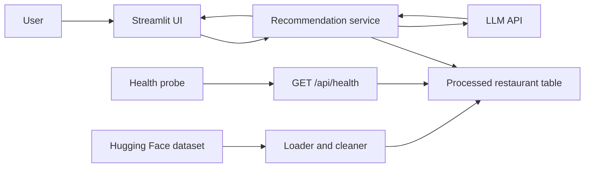
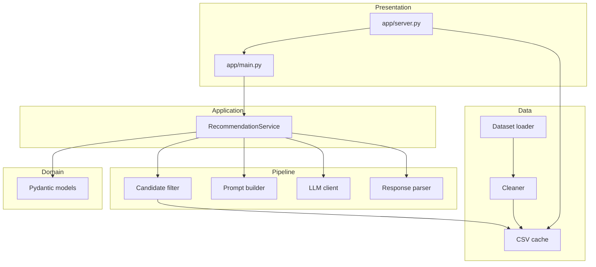
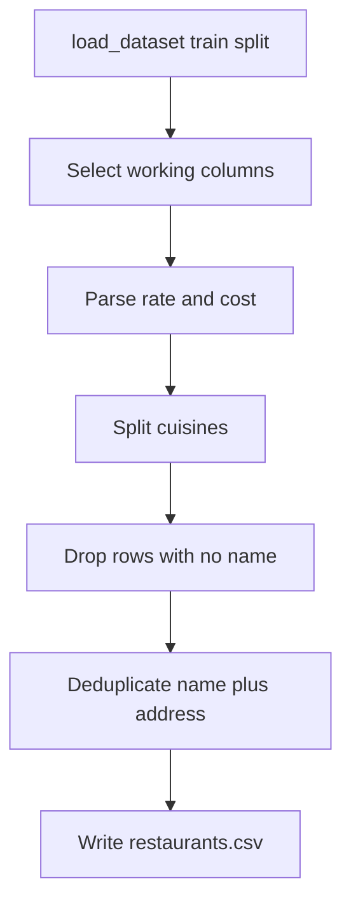
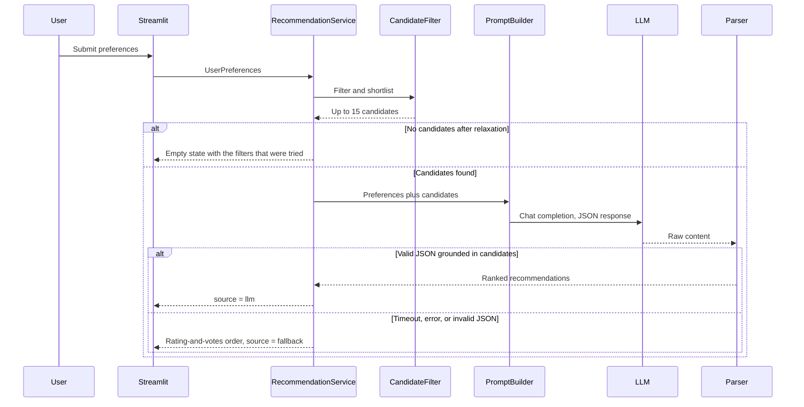

# Architecture

Python application that recommends restaurants from the Zomato dataset. Structured filters select a short list of real restaurants. An LLM ranks that short list and writes a short explanation for each pick. The UI shows name, cuisine, rating, estimated cost, and the explanation.

The dataset is [ManikaSaini/zomato-restaurant-recommendation](https://huggingface.co/datasets/ManikaSaini/zomato-restaurant-recommendation): about 51,717 rows of Bangalore listings. Location values are neighborhoods such as Banashankari and Basavanagudi, collected under `listed_in(city)`.

## Design principles

- Python for every layer: loading, cleaning, filtering, prompting, the LLM call, and the UI.
- The LLM only ranks restaurants that already passed the filters. It does not invent names, ratings, or prices.
- Heavy columns stay out of the prompt. `reviews_list` can be over a megabyte per row, and `menu_item` is large. The model receives a compact candidate record.
- Filtering is deterministic and testable. The LLM step is the only part that depends on a network and an API key.
- If the model call fails, the app still returns the filtered short list with a plain ranking based on rating and votes.
- `GET /api/health` reports whether the local cache is readable and whether an LLM key is set. It does not download the dataset or call the model.

## System context



The user talks to the Streamlit page. A probe on the same server calls `GET /api/health`. The recommendation service owns a recommendation request. The processed table is a local cache built once from Hugging Face. The LLM sees a short JSON payload, not the raw dataset. The health route reads that cache and the LLM key, and it does not call Hugging Face or the model.

## Layered structure



| Layer | Responsibility |
| --- | --- |
| Presentation | Collect preferences, render the top recommendations, and serve `GET /api/health`. |
| Application | Run one recommendation request from input to display model. |
| Domain | Typed preferences, restaurant records, and recommendation results. |
| Pipeline | Filter rows, build the prompt, call the model, parse JSON. |
| Data | Download, clean, deduplicate, and cache the working table. |

## Project layout

```text
week1lab1/
  app/
    server.py                    # st.App entry: page plus GET /api/health
    main.py                      # Streamlit page
  src/
    recommender/
      __init__.py
      config.py                  # Settings from environment
      models.py                  # Preferences, Restaurant, Recommendation
      health.py                  # Cache and LLM-key readiness
      service.py                 # Orchestrates one request
      data/
        loader.py                # Hugging Face download
        cleaner.py               # Types, dedupe, derived columns
      filtering/
        candidates.py            # Hard filters, budget bands, shortlist
      llm/
        client.py                # OpenAI-compatible chat call
        prompt.py                # System and user messages
        parser.py                # JSON to Recommendation list
  data/
    processed/
      restaurants.csv        # Local cache, not committed
  tests/
    test_cleaner.py
    test_candidates.py
    test_health.py
    test_parser.py
  docs/
    problemStatement.md
    architecture.md
  .env.example
  requirements.txt
```

Suggested libraries:

| Package | Use |
| --- | --- |
| `datasets` | Load the Hugging Face split. |
| `pandas` | Clean and filter the table, and read and write the CSV cache. |
| `pydantic` | Validate preferences and model output. |
| `openai` | Chat Completions client. Any OpenAI-compatible base URL works. |
| `python-dotenv` | Load `LLM_API_KEY` and related settings. |
| `streamlit` | Form and results page. |

## Domain model

```text
UserPreferences
  location: str                  # neighborhood or listed city, case-insensitive
  budget: Literal["low", "medium", "high"]
  cuisine: str                   # matched against comma-separated cuisines
  min_rating: float              # 0.0 to 5.0
  additional_preferences: str    # free text, passed to the LLM only
  top_n: int = 5                 # how many results to show

Restaurant
  name: str
  address: str
  location: str
  listed_in_city: str
  cuisines: list[str]
  cost_for_two: int | None
  rating: float | None
  votes: int
  rest_type: str
  online_order: bool
  book_table: bool
  dish_liked: str
  url: str

Recommendation
  rank: int
  name: str
  cuisines: str
  rating: float | None
  cost_for_two: int | None
  explanation: str
  url: str

RecommendationResult
  preferences: UserPreferences
  summary: str
  items: list[Recommendation]
  candidate_count: int
  relaxed_filters: list[str]     # empty when the original filters matched
  source: Literal["llm", "fallback"]
```

The UI binds to `RecommendationResult`. Explanations come from the model. Name, cuisine, rating, and cost are copied from the filtered row so a model cannot change the facts.

## Data pipeline

Run once at startup, or whenever the CSV file is missing.



### Source columns kept

| Source column | Working field | Cleaning rule |
| --- | --- | --- |
| `name` | `name` | Strip whitespace. Drop blank names. |
| `address` | `address` | Strip whitespace. Used for dedupe. |
| `location` | `location` | Strip and title-case for matching. |
| `listed_in(city)` | `listed_in_city` | Same normalization as location. |
| `cuisines` | `cuisines` | Split on comma, strip each token. Empty becomes an empty list. |
| `approx_cost(for two people)` | `cost_for_two` | Remove commas and parse to int. Unparseable values become null. |
| `rate` | `rating` | Take the number before `/`. Values such as `NEW`, `-`, and blanks become null. |
| `votes` | `votes` | Parse to int. Commas removed. Missing becomes 0. |
| `rest_type` | `rest_type` | Keep as text. Used as a hint for service style. |
| `online_order` | `online_order` | `Yes` to true, otherwise false. |
| `book_table` | `book_table` | `Yes` to true, otherwise false. |
| `dish_liked` | `dish_liked` | Keep a short string. Truncate to 200 characters. |
| `url` | `url` | Keep for the result card. |

`phone`, `menu_item`, and `reviews_list` are dropped during cleaning. They are large, and they are not shown on the result card.

### Duplicates

The same restaurant appears more than once because Zomato lists it under several `listed_in(type)` and `listed_in(city)` values. Dedupe on normalized `name` + `address`, and keep the row with the highest `votes`.

### Budget bands

`budget` is a user label. The filter uses `cost_for_two`:

| Budget | Cost for two (INR) |
| --- | --- |
| low | 1 to 400 |
| medium | 401 to 800 |
| high | 801 and above |

Rows with a null cost fail the budget filter. These cutoffs are configuration values in `config.py`, so they can change without touching filter logic.

## Request lifecycle



`RecommendationService.recommend(preferences)` is the only public entry point the UI calls.

Steps inside the service:

1. Validate preferences with Pydantic.
2. Load the processed table. Build it on first use.
3. Apply hard filters.
4. If the short list is empty, relax filters in a fixed order and record what changed.
5. Score remaining rows and keep the top 15.
6. Ask the LLM to rank those 15 and return the top `top_n` with explanations and a one-paragraph summary.
7. Join model output back to candidate rows by restaurant name. Discard any name that was not in the short list.
8. On failure, sort the same short list by score and fill explanations with a fixed template.

## Candidate filter

Hard filters, applied together:

- **Location.** Case-insensitive match on `location` or `listed_in_city`. A value matches when it equals the field or is contained in it, so `Banashankari` matches `Banashankari` and listings filed under that city label.
- **Cuisine.** Case-insensitive match against any token in `cuisines`. `Italian` matches `Cafe, Mexican, Italian`.
- **Minimum rating.** `rating >= min_rating`. Rows with a null rating are excluded.
- **Budget.** `cost_for_two` falls inside the selected band.

Shortlist score, used only to choose which rows the model sees:

```text
score = rating * log(1 + votes)
```

Higher-rated places with more votes are preferred when many rows match. The score is not shown to the user. The model may reorder the short list.

### Relaxation order

Stop at the first step that yields at least one row:

1. Original filters.
2. Drop the cuisine constraint and keep location, rating, and budget.
3. Widen budget by one step: low also accepts medium, medium accepts low and high, high also accepts medium.
4. Drop the minimum rating.

Each applied step is appended to `relaxed_filters` and mentioned in the UI so the user can see why a result is outside the original request. Additional free-text preferences are never a hard filter. They are prompt context only, because phrases such as "family-friendly" or "quick service" are not columns. `rest_type`, `online_order`, and `book_table` are included on each candidate so the model can use them when the text asks for quick service or a place that takes bookings.

## LLM integration

### Client

`llm/client.py` wraps the OpenAI Python SDK. Settings come from the environment:

| Variable | Purpose |
| --- | --- |
| `LLM_API_KEY` | API key. Required for live recommendations. |
| `LLM_BASE_URL` | Optional. Set this for a compatible provider such as Groq. |
| `LLM_MODEL` | Chat model name. |
| `LLM_TIMEOUT_SECONDS` | Default 30. |

The client sends one chat completion with `temperature` 0.2 and `response_format` set to JSON object when the provider supports it. It returns the message content as a string. It does not parse JSON.

### Prompt

System message:

- Recommend only from the candidate list.
- Do not add restaurants, and do not change rating or cost.
- Use `additional_preferences` when choosing the order and writing explanations.
- Return JSON only, matching the schema below.
- Write explanations in two or three sentences, tied to cuisine, rating, cost, and the user's extra preferences.

User message:

- The preference object.
- A JSON array of candidates. Each item includes `name`, `location`, `cuisines`, `cost_for_two`, `rating`, `votes`, `rest_type`, `online_order`, `book_table`, and `dish_liked`.

Expected JSON:

```json
{
  "summary": "Short overview of the set.",
  "recommendations": [
    {
      "rank": 1,
      "name": "Exact candidate name",
      "explanation": "Why this place fits."
    }
  ]
}
```

The prompt asks for exactly `top_n` items, ordered by `rank` starting at 1.

### Parser

`llm/parser.py`:

- Parse the content as JSON.
- Require `summary` and `recommendations`.
- Keep an item only when `name` matches a candidate exactly.
- Copy cuisine, rating, cost, and url from that candidate.
- If fewer than `top_n` valid items remain, fill the rest from the unused candidates in score order and mark the result `source = fallback` only when the model returned nothing usable. A partial list stays `source = llm` and is padded so the page is never half empty.
- Raise `InvalidModelOutput` when the payload is not JSON or contains no usable names. The service catches that and uses the fallback.

## Fallback ranking

Used when the API key is missing, the call times out, the provider returns an error, or the parser rejects the payload.

1. Sort the short list by `score` descending.
2. Take `top_n`.
3. Set `summary` to a sentence that states the results were ordered by rating and number of votes.
4. Set each `explanation` to a template that names the cuisine, rating, cost for two, and location. The template does not claim the model wrote it.
5. Set `source` to `fallback`.

## Presentation

Streamlit app in `app/main.py`.

Form fields:

- Location: text input, with example `Banashankari`.
- Budget: select box, `low`, `medium`, `high`.
- Cuisine: text input, with example `Italian`.
- Minimum rating: slider from 0.0 to 5.0, step 0.1, default 3.5.
- Additional preferences: text area.
- Submit button.

Results:

- Summary paragraph.
- A note when `relaxed_filters` is non-empty, listing which constraints were widened.
- A note when `source` is `fallback`.
- One card per recommendation: rank, name, cuisines, rating, cost for two, explanation, and a link to `url`.

The page does not import Hugging Face or the LLM SDK directly. It calls `RecommendationService`.

## Health endpoint

`app/server.py` is the process entry. `streamlit run app/server.py` serves `app/main.py` and mounts `GET /api/health` on the same port.

The route calls `check_health` in `src/recommender/health.py`. The body is:

```json
{
  "status": "ok",
  "checks": {
    "cache": {"ok": true, "detail": "Restaurant cache is readable at data/processed/restaurants.csv (N rows)."},
    "llm": {"ok": true, "detail": "LLM API key is set. This check does not call the model."},
    "huggingface": {"ok": true, "detail": "Not called. The local restaurant cache is in use."}
  }
}
```

| `status` | Meaning | HTTP |
| --- | --- | --- |
| `ok` | The cache is readable and `LLM_API_KEY` is set. | 200 |
| `degraded` | The cache is readable and the key is missing. Recommendations use the rating-and-votes fallback. | 200 |
| `unavailable` | The cache is missing or cannot be read. | 503 |

The response never includes the key. Hugging Face is not called. A missing cache says the next recommendation request will try the download. An unreadable cache says the app will not download again. A live model call is not part of this probe.

## Configuration

`config.py` reads environment variables and exposes one `Settings` object:

- LLM settings from the table above.
- `DATA_CACHE_PATH`, default `data/processed/restaurants.csv`.
- `CANDIDATE_LIMIT`, default 15.
- `DEFAULT_TOP_N`, default 5.
- Budget band edges.

`.env.example` lists every variable with placeholders. The real `.env` stays out of version control.

## Error handling

| Situation | Behavior |
| --- | --- |
| Hugging Face download fails and no cache exists | Show an error and stop. Do not call the LLM. |
| Cache exists | Use the cache and skip the download. |
| Preferences fail validation | Show the field errors. Do not query. |
| Filters match nothing, including after relaxation | Empty state that restates the filters. |
| LLM timeout or HTTP error | Fallback ranking. |
| LLM returns non-JSON or unknown names | Fallback ranking. |
| Missing API key | Fallback ranking, with the UI stating that live explanations need a key. `GET /api/health` returns `degraded`. |
| Cache missing or unreadable | `GET /api/health` returns `unavailable` and does not download the dataset. |

## Testing

Tests stay offline. They do not download the dataset and they do not call the LLM.

| Test module | Covers |
| --- | --- |
| `test_cleaner.py` | Rating strings (`4.1/5`, `NEW`, `-`), cost strings with commas, cuisine splitting, dedupe keeping the higher-vote row. |
| `test_candidates.py` | Each hard filter, budget edges, relaxation order, shortlist size. |
| `test_health.py` | Readable cache, missing key, missing cache, unreadable cache. No dataset download and no model call. |
| `test_parser.py` | Valid JSON, extra restaurants dropped, unusable payload raising `InvalidModelOutput`. |

Use small in-memory DataFrames as fixtures.

## Runtime

```text
pip install -r requirements.txt
copy .env.example .env          # then set LLM_API_KEY and LLM_MODEL
streamlit run app/server.py
```

The page is `app/main.py`. The same process serves `GET /api/health`. First launch of a recommendation builds `data/processed/restaurants.csv`. Later launches read that file. The health route does not build the cache.

## Boundaries

This design is a single-process app for one user at a time. It does not include user accounts, saved searches, a database server, or a vector index. Retrieval is pandas filtering on the cached table, which is enough for this dataset once the heavy text columns are removed.
